# Backend Design — Python OOP Application Logic

**Project:** Enterprise Employee Analytics & Data Warehouse System
**Phase:** 3 — Python application logic (OOP)
**Status:** Implemented and verified
**Code:** [`src/db_manager.py`](../src/db_manager.py) · [`src/exceptions.py`](../src/exceptions.py) ·
[`src/models/`](../src/models/) · [`src/dal/`](../src/dal/) ·
[`sql/07_oltp_procedures.sql`](../sql/07_oltp_procedures.sql) (onboarding, exits, shared position rules)
**Proof:** [`tests/test_models.py`](../tests/test_models.py) (72 tests, no database) ·
[`tests/test_managers.py`](../tests/test_managers.py) (51 tests on the 100K data) ·
[`tests/test_schema_manager.py`](../tests/test_schema_manager.py) (6 tests)

---

## 1. What the problem statement requires

> *"Moving away from functional programming, build a modular Object-Oriented backend:*
> *1. db_manager.py: Create a DatabaseConnection class utilizing Singleton design patterns to manage
> MySQL connections safely.*
> *2. Entity Classes: Create classes for Employee, Project, and Review that encapsulate attributes and
> behaviors.*
> *3. Data Access Layer (DAL): Create Manager classes (e.g., EmployeeManager, AnalyticsManager) that
> inherit from your DB classes to handle CRUD operations. Implement robust try-except blocks for
> error handling."*

The evaluation criterion it serves: *"Python Architecture: clean, modular OOP design with proper
encapsulation and error handling."* Phase 4 builds its forms and dashboards on these classes only.

| Requirement | Where |
|---|---|
| Singleton `DatabaseConnection` in `db_manager.py` | `src/db_manager.py` — one instance per class, one shared connection pool (§5) |
| Entity classes Employee, Project, Review | `src/models/` — plus `Position` and `Assignment`, which the forms need (§4) |
| Managers inheriting from the DB class | `src/dal/` — seven managers, each `class …Manager(DatabaseConnection)` (§7) |
| CRUD | create / read / update for employees, projects, assignments, reviews; delete where the business allows it (§7) |
| Robust try-except | every database call runs in `transaction()`: try → commit, except → rollback + translated error, finally → cursor closed, connection returned; a busy pool is waited for and a generated code taken by a simultaneous insert is retried (§5) |
| "Moving away from functional programming" | every database operation is a method of a class that inherits from `DatabaseConnection`, schema installation included (`SchemaManager`); the files in `scripts/` are thin command-line front ends |

## 2. Layers

```
 Streamlit pages (Phase 4)        forms and charts only — no SQL
        │  build entities, call managers, show exceptions' messages
        ▼
 Managers (src/dal)               SQL, transactions, business checks that need other records
        │  inherit from
        ▼
 DatabaseConnection               Singleton per class, ONE shared pool, transactions, error translation
        │
        ▼
 MySQL: hr_oltp (procedures, constraints)  ·  hr_dw (star schema, SCD Type 2)

 Entities (src/models)            validated, immutable objects passed between the layers;
                                  they never touch the database
```

```
src/
├── db_manager.py        DatabaseSettings, DatabaseConnection, translate_error
├── exceptions.py        the exception hierarchy (§5.3)
├── models/
│   ├── base.py          Entity (abstract base), Rules, shared helpers
│   ├── employee.py      Employee, Position
│   ├── project.py       Project, Assignment
│   └── review.py        Review
└── dal/
    ├── reference_manager.py   ReferenceDataManager   drop-down lists (cached)
    ├── employee_manager.py    EmployeeManager        hire, read, correct, change job (SCD2), exit
    ├── project_manager.py     ProjectManager         projects and assignments
    ├── review_manager.py      ReviewManager          performance reviews
    ├── analytics_manager.py   AnalyticsManager       warehouse queries for the dashboards
    ├── etl_manager.py         EtlManager             runs the ETL procedures (Phase 2)
    └── schema_manager.py      SchemaManager          installs the numbered SQL scripts (setup)
```

## 3. Class diagram

```mermaid
classDiagram
    class DatabaseConnection {
        <<Singleton per class>>
        -_instances$ dict
        -_pool$ MySQLConnectionPool
        +connection()
        +transaction(dictionary)
        +rollback_session()$
        +in_rollback_session()$ bool
        +fetch_all(sql, params) list
        +fetch_one(sql, params) dict
        +fetch_frame(sql, params) DataFrame
        +execute(sql, params) int
        +call_in(cursor, name, args, out_params)$ tuple
        +call_procedure(name, args, out_params) tuple
        +run_with_retry(work, unique_key) result
    }
    class ReferenceDataManager {
        -_cache dict
        +departments() roles_for(dept) levels_for(role)
        +manager_candidates(dept, min_level)
    }
    class EmployeeManager {
        +onboard(Employee, Position) Employee
        +get(id) get_by_code(code) profile(id) search(...)
        +current_position(id) Position
        +history(id) DataFrame
        +update_details(Employee) Employee
        +change_position(id, Position, date, reason) PositionChange
        +record_exit(id, date, reason) int
    }
    class ProjectManager {
        +create(Project) get(id) search(...) update(Project) delete(id)
        +assign(Assignment, allow_over_allocation) Assignment
        +end_assignment(id, date) remove_assignment(id)
        +team(project) assignments_for(emp) allocation_on(emp, day)
    }
    class ReviewManager {
        +submit(Review) get(id) reviews_for(emp)
        +suggest(emp, year) dict
        +withdraw(id)
    }
    class AnalyticsManager {
        -_cache OrderedDict
        +data_version() tuple
        +overview() yoy_trends() attrition_trend()
        +top_performers() scored_workforce() attrition_risk()
        +risk_summary() risk_factor_prevalence() risk_backtest()
        +project_delivery() bottleneck_projects()
    }
    class EtlManager {
        +migrate_staging() run_warehouse_etl() recent_batches()
    }
    class SchemaManager {
        +scripts(only) server() loaded_tables()
        +install(scripts, force) run_script(script)
    }
    DatabaseConnection <|-- SchemaManager
    DatabaseConnection <|-- ReferenceDataManager
    DatabaseConnection <|-- EmployeeManager
    DatabaseConnection <|-- ProjectManager
    DatabaseConnection <|-- ReviewManager
    DatabaseConnection <|-- AnalyticsManager
    DatabaseConnection <|-- EtlManager

    class Entity {
        <<abstract>>
        +validation_errors()* dict
        #_normalize()
        +from_row(row)$ Entity
        +to_record() dict
        +with_changes(changes) Entity
    }
    class Employee {
        +full_name  +is_active
        +age_on(day) tenure_on(day) total_experience_on(day)
    }
    class Position {
        +changes_from(previous) dict
        +is_promotion_from(previous) is_transfer_from(previous)
    }
    class Project {
        +is_closed  +delay_days  +is_delayed  +planned_duration_days
        +is_overdue_on(day) close(status, on) Project
    }
    class Assignment {
        +is_open  +active_on(day)  +end(on) Assignment
    }
    class Review {
        +rating_label  +is_outstanding  +is_held_in_following_year
    }
    Entity <|-- Employee
    Entity <|-- Position
    Entity <|-- Project
    Entity <|-- Assignment
    Entity <|-- Review

    EmployeeManager ..> Employee
    EmployeeManager ..> Position
    EmployeeManager ..> PositionChange : returns
    ProjectManager ..> Project
    ProjectManager ..> Assignment
    ReviewManager ..> Review
    AnalyticsManager ..> AnalyticsFilter : filters
    AnalyticsManager ..> RiskFactor : score
```



## 4. Entity classes (`src/models`)

Every entity is an **immutable (frozen) dataclass** that inherits from the abstract `Entity` and
**validates itself on creation** (decision B1):

- An invalid `Employee`, `Project` or `Review` cannot exist. `Employee(email="x")` raises
  `ValidationError` with every broken rule at once — `{"email": …, "phone": …, "hire_date": …}` —
  so a form can show all problems together.
- Nobody can change an entity afterwards: `employee.email = …` raises `FrozenInstanceError`.
  A change is a new object, `employee.with_changes(email=…)`, which is validated again.
- `_normalize()` brings loose input into canonical types before validation: names and e-mails
  trimmed, e-mails lower-cased, money as `Decimal` rounded to cents, database `TINYINT` flags as
  `bool`, and NumPy values (a selection from a DataFrame column) as plain Python values.
- `from_row()` builds any entity from a database row (extra columns ignored); `to_record()` is
  the reverse. One implementation in the base class serves all five subclasses.

| Entity | Mirrors | Rules checked by the entity | Behaviour |
|---|---|---|---|
| `Employee` | `hr_oltp.employees` | code `EMP` + 6 digits; names are letters with single `space . ' ’ -` between; e-mail and phone format; gender, marital status from the allowed lists; distance 1–50 km; prior experience 0–50, previous employers 0–20, and 0 exactly when there is no experience (D19); at least 18 on the hire date; exit date and reason together, not before the hire | `full_name`, `is_active`, `age_on()`, `tenure_on()`, `total_experience_on()` (IBM's TotalWorkingYears) |
| `Position` | `hr_oltp.employee_job_history` | ids present, level 1–5, positive income, stock 0–3, travel from the list | `changes_from()`, `is_promotion_from()`, `is_transfer_from()` |
| `Project` | `hr_oltp.projects` | code `PRJ` + 5 digits; name 1–120; budget positive; status and priority from the lists; planned end ≥ start; actual end ≥ start; **an actual end date exactly when Completed or Cancelled** | `is_closed`, `planned_duration_days`, `delay_days` / `is_delayed` (completed projects only — same rule as `dim_project`), `is_overdue_on()`, `close()` |
| `Assignment` | `hr_oltp.project_assignments` | allocation 1–100 %, role 1–30, end ≥ start | `is_open`, `active_on()`, `end()` |
| `Review` | `hr_oltp.performance_reviews` | not self-reviewed; rating 1–4; KPI 0–100; training 0–20; year 2000–2100; held in the review year or the next | `rating_label` (IBM scale), `is_outstanding`, `is_held_in_following_year` |

**The rules were checked against the data:** all 1,377,241 OLTP rows (100,000 employees,
308,986 job versions, 2,000 projects, 503,240 assignments, 463,015 reviews; checked again after
the review-history fix) were loaded into their entity classes. The first run rejected 153 surnames such as **"D’Alia"** — they use the
typographic apostrophe ’, which the name rule did not allow. The rule was wrong, not the data;
after the fix, 0 rows are rejected. Python and the database therefore agree on what is valid.

## 5. `DatabaseConnection` and error handling (`src/db_manager.py`)

### 5.1 Singleton per class, one shared pool

`__new__` keeps one instance **per class** in `_instances`, and `__init__` creates the MySQL
connection pool once, on first use, in a class attribute (under a lock, so two threads cannot
both create it). Consequences:

- `EmployeeManager() is EmployeeManager()` — a Singleton, as the problem statement asks.
- `EmployeeManager()` and `AnalyticsManager()` are different objects but **share the one pool**
  (5 connections by default) — the whole application, every Streamlit session included, uses at
  most five MySQL connections.
- Because each manager inherits from `DatabaseConnection`, it inherits the Singleton behaviour
  without any code of its own.

### 5.2 Transactions: try / except / finally in one place

```python
with self.transaction() as cur:        # borrows a pooled connection
    cur.execute(...)                   # any number of statements and procedure calls
                                       # success   -> COMMIT
                                       # MySQL error -> ROLLBACK, then raise the translated error
                                       # other error -> ROLLBACK, re-raise
                                       # always    -> close the cursor, return the connection
```

Every manager method runs its work inside `transaction()`, so the error handling is written once
and cannot be forgotten. A rollback that itself fails is logged and the *original* error is
raised (it is the one that explains what happened).

**Several users at once** (decisions B18, B19):
- **A busy pool is waited for.** When all five connections are in use, for example during
  several long dashboard queries, a request waits up to `DB_POOL_WAIT` seconds (default 10) for
  one to be returned. Only then does it fail, with "All 5 database connections are busy —
  please try again in a moment". A connection the server has closed in the meantime is
  reconnected by the pool itself.
- **A taken code is retried.** Two users onboarding at the same moment both read the highest
  employee code, and the UNIQUE key refuses the second insert. `run_with_retry()` rolls that
  attempt back and runs it again, reading the new highest code (up to 3 attempts). It retries
  only when the constraint behind the error is the code's own unique key, which
  `translate_error` reads from MySQL's message. A taken e-mail address, for instance, is
  reported at once. Project creation works the same way.

### 5.3 MySQL errors become application errors

```
HRAppError
├── ConfigurationError      a setting is missing or invalid
├── DatabaseError           the database could not do its job (connection, unexpected SQL error)
├── ValidationError         input breaks a rule            -> the user can fix the form
├── BusinessRuleError       the database refused the change -> the user can fix the input
│   ├── DuplicateError          the record already exists
│   └── OverAllocationError     an assignment would take someone above 100 %
└── NotFoundError           the requested record does not exist
```

| MySQL error | Becomes | Example message the UI shows |
|---|---|---|
| 1644 `SIGNAL` from a procedure | `BusinessRuleError` | "This job role does not exist in the selected department" |
| 1062 duplicate key | `DuplicateError` | "This e-mail address is already used by another employee" |
| 1452 foreign key on insert | `BusinessRuleError` | "The selected project does not exist" |
| 1451 foreign key on delete | `BusinessRuleError` | "The project still has assignments — cancel it instead of deleting it" |
| 3819 CHECK constraint | `ValidationError` | "An employee cannot review themselves" |
| 1048 / 1264 / 1406 … bad value | `ValidationError` | MySQL's text, e.g. "Data too long for column …" |
| anything else | `DatabaseError` | "2013: Lost connection to MySQL server …" |

The friendly messages are keyed by **(error number, constraint name)**, because the same foreign
key means "does not exist" on an insert and "still in use" on a delete. The Streamlit pages will
show `ValidationError` / `BusinessRuleError` / `NotFoundError` as warnings and `DatabaseError` as
an error.

### 5.4 The rollback session (how the tests use the real data safely)

`DatabaseConnection.rollback_session()` pins every manager in the current thread to **one**
connection and rolls everything back at the end (decision B6). Inside it, each `transaction()`
becomes a `SAVEPOINT`: a failed step is undone on its own and the earlier steps stay visible to
the later ones, exactly as in the real application — but nothing is ever committed. A test
proves it: an employee onboarded inside the session is visible there and gone afterwards. (The
ETL entry points commit by design, so they are never run inside a session.)

## 6. Business rules: three layers (decision B2)

| Layer | Checks | Why there |
|---|---|---|
| **Entity** | formats, ranges, date order — anything that needs only the object itself | instant feedback in the form, no database round trip |
| **Stored procedure / manager** | rules that need other records: the role is offered in the department, the level is inside the role's range, the pay is inside the level's band, the manager is an active employee, the project is open, the reviewer was employed on the review date | they need the reference tables; in the database they also protect Workbench users |
| **Constraints** | keys, foreign keys, CHECKs (already in the DDL) | the last guard, whatever the client |

New procedures in `sql/07_oltp_procedures.sql` (none of them commits — the manager commits the
OLTP change and its warehouse update together, etl_design E3):

| Procedure | Does |
|---|---|
| `sp_validate_position` | the four position rules, written **once** and called by both procedures below |
| `sp_onboard_employee` | generates the next employee code, inserts the employee and the first job version ('Hire'); the manager then calls `hr_dw.sp_scd2_apply_employee`, so the new hire is in the warehouse at once |
| `sp_record_exit` | records the exit (never a delete — history must stay reportable), ends open assignments, removes assignments that would only have started later; refuses an exit before the last job change or the last review |
| `sp_change_employee_position` (Phase 2) | now calls `sp_validate_position` instead of its own copy of the rules |

## 7. The managers (`src/dal`)

| Manager | Create | Read | Update | Delete |
|---|---|---|---|---|
| `EmployeeManager` | `onboard()` → OLTP rows + warehouse version 1 | `get()`, `get_by_code()`, `profile()`, `search()`, `current_position()`, `history()` (SCD2 versions) | `update_details()` (personal data — SCD Type 1 in the warehouse); **`change_position()`** (SCD Type 2); `record_exit()` | never — an exit is recorded instead |
| `ProjectManager` | `create()` (next code), `assign()` | `get()`, `search()`, `team()`, `assignments_for()`, `allocation_on()` | `update()` (closing a project ends its assignments), `end_assignment()` | `delete()` only for a Planned project nobody is assigned to or reviewed on; `remove_assignment()` for a mistake |
| `ReviewManager` | `submit()` | `get()`, `reviews_for()`, `suggest()` (form defaults: the manager at year end, the main project that year) | — (a review is a record of what was said) | `withdraw()` only while not yet in the warehouse |
| `ReferenceDataManager` | — | departments, **roles offered in a department**, levels a role allows with salary bands, manager candidates, education, exit reasons, ratings (cached) | — | — |
| `AnalyticsManager` | — | the dashboard queries (§8) | — | — |
| `EtlManager` | — | ETL batches, steps, rejected rows | runs the two ETL stages | — |
| `SchemaManager` | installs the numbered SQL scripts (`scripts/setup_database.py`) | the scripts, the server version, which protected tables hold data | re-installs views and procedures (`--only 03 07 08`) | refuses to drop tables that hold data unless forced — checked before anything runs |

Highlights:

- **`change_position()` is the Phase 4 requirement.** One transaction: the OLTP version is closed
  and a new one opened (`sp_change_employee_position`), then `sp_scd2_apply_employee` expires the
  warehouse row (end date = yesterday, `is_current = 0`) and inserts the new current version.
  It returns a `PositionChange` with the derived reason ("Transfer") and the employee's warehouse
  versions, so the UI can show the SCD Type 2 step — old row expired, new row current.
- **Over-allocation:** `assign()` adds up the employee's allocation on the start date; above
  100 % it raises `OverAllocationError` with both numbers, and the form can offer "assign anyway"
  (`allow_over_allocation=True`) — over-allocation is real, and it is what bottleneck analysis
  looks for.
- **Codes are generated by the database** (`MAX + 1` on the fixed-width code). If two users
  save at the same moment, the UNIQUE key refuses the second, and the manager retries it with
  the next code (§5.2).
- **When changes reach the warehouse (B5):** employee changes immediately (SCD Type 2 needs the
  version history); projects and reviews on the next ETL run (about 50 s, a "Run ETL" button in
  Phase 4), as a warehouse normally works. Deleting a planned project also removes its
  `dim_project` row, logged as a batch like every warehouse change.

## 8. `AnalyticsManager` — the dashboard queries

All analytics read the star schema only, with **parameterized CTEs and window functions in the
manager** (decision B7) — not views, because a `DENSE_RANK()` inside a view ranks everybody
before the dashboard's filters apply. `AnalyticsFilter` (departments, job levels, review cycles)
turns the filters into bound `IN (%s, …)` conditions; only values come from the user, column
names come from the code.

| Dashboard (Phase 4) | Method | SQL |
|---|---|---|
| Headline numbers | `overview()` | headcount, attrition of the latest complete fiscal year, latest cycle vs the one before, project delivery |
| **Year-over-year performance trends** | `yoy_trends(period, by_department)` | CTE per cycle → `LAG()` over the cycles (per department with `PARTITION BY`): rating, KPI, % outstanding, % low rated, overtime, satisfaction, training |
| Attrition trend | `attrition_trend(by_department)` | leavers ÷ average headcount per fiscal year with `LAG()`; headcounts **point-in-time through SCD Type 2** — people are counted in the department and level of the version valid on the day |
| **Top performers by department** | `top_performers(top_n, min_reviews, active_only)` | aggregate per employee → **`DENSE_RANK() OVER (PARTITION BY department ORDER BY avg rating DESC, avg KPI DESC)`** → `COUNT(*) OVER` for ties |
| **Attrition risk** | `scored_workforce()`, `attrition_risk()`, `risk_summary()`, `risk_factor_prevalence()`, `risk_backtest()` | `ROW_NUMBER()` (latest review), `NTILE(4)` (pay quartile within level), `PERCENT_RANK()` (risk percentile), `SUM() OVER ()` (shares) |
| **Project bottlenecks** | `project_delivery(by)`, `bottleneck_projects()` | delay by priority / budget / department / year; overdue open projects with `RANK()` and their reviewed teams' overtime and KPI |

### 8.1 The attrition-risk score (decision B8)

A transparent **points score**, not a black-box model. Each factor was measured on the warehouse
— the share of employees who left within a year of a review (379,827 reviews with a fully
observed following year; overall 3.15 %). Measured again after the review-history fix
(synthesizer_design.md D26–D27; decision B21):

| Factor | Points | Left within a year: with → without |
|---|---|---|
| Works overtime | 2 | 6.4 % → 2.0 % |
| Entry level (job level 1) | 2 | 5.5 % → 0.8–2.7 % |
| No stock options | 2 | 5.0 % → 1.4–3.7 % |
| Less than 2 years at the company | 1 | 4.9–5.1 % → 2.2–2.9 % |
| Low environment satisfaction (1 of 4) | 1 | 5.4 % → 2.5–3.0 % |
| Low job satisfaction (1 of 4) | 1 | 4.4 % → 2.3–3.3 % |
| Poor work-life balance (1 of 4) | 1 | 6.8 % → 2.8–3.4 % |
| Low job involvement (1 of 4) | 1 | 7.4 % → 1.7–3.9 % |
| Travels frequently | 1 | 4.7 % → 1.4–3.0 % |
| Lives more than 10 km away | 1 | 3.9–4.2 % → 2.6–2.9 % |
| Paid in the lower half of the level (`NTILE(4)` within level and cycle) | 1 | 3.7–4.5 % → 1.7–2.8 % |

**Deliberately left out:**
- **Marital status, age and gender.** "Single" does predict attrition here (5.1 % against 2.0 %),
  but these are protected personal characteristics. HR should not score people on them, and HR
  cannot act on them. Leaving marital status out did not weaken the score (B9).
- **Measures without a useful signal.**
  - The performance rating: 3.2 % against 3.0 %.
  - Relationship satisfaction: 4.2 % against 2.9 %, the weakest effect; left out to keep the
    score compact.
- **Patterns that contradict HR experience**, which are probably artifacts of the synthesis:
  recently promoted people leaving most.

**Bands and back-test** (`risk_backtest()`: every past review scored with what was known at the
time, i.e. the employee version and survey of that review):

| Band (score) | Share of reviews | Left within a year | Share of all leavers | Lift |
|---|---|---|---|---|
| Low (0–2) | 29.8 % | 0.72 % | 6.9 % | 0.23 |
| Medium (3–5) | 50.9 % | 1.84 % | 29.8 % | 0.58 |
| High (6–7) | 15.4 % | 7.96 % | 38.9 % | 2.53 |
| Very high (8+) | 3.9 % | **19.55 %** | 24.5 % | **6.21** |

The High and Very high bands hold 19 % of employees but 63 % of the leavers. Today (83,878 active
employees) the bands hold 26,648 / 46,640 / 9,674 / 916 people.

The score is computed **once for the whole company** (`scored_workforce()`); the risk list,
summary and factor prevalence are slices of it. That way a dashboard filter can never change
anyone's score: pay quartiles and percentiles are always company-wide.

### 8.2 Cache and performance

The warehouse holds 463,015 facts and 308,986 employee versions. The managers' writes take
2–15 ms each (a department change with its SCD Type 2 step: 14 ms). The analytics queries,
measured on the development laptop (MySQL 8.0.46, default 128 MB buffer pool):

| Query | First call | Cached |
|---|---|---|
| `yoy_trends()` | 2.4–2.7 s (was 5.2 s) | 1 ms |
| `yoy_trends()` with a job-level filter | 4.6 s | 2 ms |
| `attrition_trend()` | 3.4–3.6 s | 1–2 ms |
| `top_performers()` (one cycle) | 4.9–5.2 s (was 7.9 s) | 2–3 ms |
| `scored_workforce()` — every risk view | 18–20 s once (was 19.5 s **per view**, 36 s for the summary) | 8–16 ms; views 10–20 ms |
| `risk_backtest()` | 20–22 s | 2–9 ms |
| project queries, `overview()` | ≤ 0.75 s | ≤ 1 ms |

(Ranges: measured before and after the review-history fix; the data volume is the same.)

How it got there (each step measured with `EXPLAIN ANALYZE`):
- `yoy_trends()` joins `dim_employee` only when a job-level filter needs it. The join costs
  463,015 single-row lookups, about 3 s.
- `top_performers()` checks "still employed" *after* aggregating. As a scan filter, the
  optimizer underestimated it (30K estimated, 265K actual) and read every active employee's
  reviews before applying the cycle filter.
- The risk windows run over narrow rows (ids and numbers); names are joined at the end.
- **Tried and rejected:**
  - A forced hash join, with index hints: saved 1.8 s, at the cost of brittle SQL.
  - A "packed `MAX`" instead of `ROW_NUMBER()`: about 4 s faster, but harder to read.
  - Enlarging the buffer pool: it already serves 99.91 % of page reads from memory, so it
    isn't the bottleneck.

**The cache** (in `AnalyticsManager`, so it is independent of Streamlit) is keyed by the warehouse
version: the id of the latest *finished* ETL batch, plus the date. Every change to `hr_dw` runs
as a logged batch: an ETL run, an employee's SCD Type 2 apply, or a project deletion. A batch's
status leaves STARTED in the same commit as its data, so a query that runs during an ETL can
never be cached as the new version. Cached results are handed out as copies, and the cache is
bypassed inside a rollback session, so uncommitted data never reaches it. It holds up to 128
results.

### 8.3 Notes on the data the dashboards will show

- **Resolved: the step in the latest cycle.** The first version of the data had a jump in
  FY2025-26: 0 % low ratings against about 4 % before, 24 % overtime against 35–37 %, and the
  average rating up by 0.039. The latest review carries IBM's values, and IBM uses only ratings
  3 and 4, while earlier years had been generated differently. Fixed at the source, in the
  synthesizer (D26–D27, journal step 20). Now:
  - average rating 3.151–3.155 and outstanding share 15.1–15.5 % in every cycle;
  - year-over-year rating changes of 0.001–0.003;
  - overtime falling smoothly from 26.7 % to 24.1 %, because earlier cycles hold more people
    who later left.

  Rating and KPI lines are therefore nearly flat. The variation worth showing is by department,
  by job level, in overtime and in attrition. No trend was invented (decision H2).
- **Resolved: ties at the top.** KPI scores used to be clipped at 100, so dozens of people per
  department shared rank 1. They are now drawn without pile-ups, and rank 1 in a single cycle is
  shared by 1–3 people (latest cycle: HR 1, R&D 3, Sales 2). `DENSE_RANK()` still gives true
  ties the same rank, and `sharing_rank` says how many share it.
- **Attrition per fiscal year, not "the last 12 months".** The synthesized history ends on
  2026-06-30, so a rolling window ending today would include four months without data.
  FY2026-27 is shown as running (`is_complete = 0`).

## 9. OOP principles — where each one is

| Principle | Where |
|---|---|
| **Abstraction** | `Entity` is an abstract base class: `validation_errors()` is abstract, every entity must implement it. Managers expose business operations (`onboard`, `change_position`, `assign`) and hide SQL, procedures and transactions. |
| **Encapsulation** | Entities are frozen and validate themselves, so their state cannot be made invalid. Managers keep their caches and the pool private. The SQL of each area lives only in its manager. Callers see application exceptions, never MySQL error numbers. |
| **Inheritance** | Seven managers inherit connection handling, transactions, error translation, the retry of taken codes and the Singleton from `DatabaseConnection`. Five entities inherit construction-time validation, `from_row`, `to_record` and `with_changes` from `Entity`. |
| **Polymorphism** | `Entity.__post_init__` calls `self._normalize()` and `self.validation_errors()`, and each subclass supplies its own. `Entity.from_row(row)` builds the right subclass. Every manager uses the same `transaction()`, whatever it does inside. |
| **Singleton** | `DatabaseConnection.__new__`, one instance per class (§5.1) |
| **Value objects** | `PositionChange`, `AnalyticsFilter`, `RiskFactor` — small immutable results and parameters |

## 10. Tests

| File | Tests | Covers |
|---|---|---|
| `tests/test_models.py` | 72, no database, 0.7 s | every entity rule (parametrized), immutability, `with_changes` re-validation, normalization, NumPy values, all-errors-at-once, behaviour (`delay_days`, `tenure_on`, …), `from_row` round trip; MySQL error translation and the constraint it names; `AnalyticsFilter` SQL and validation; risk bands cover every score and contain no personal characteristic |
| `tests/test_managers.py` | 51, on the 100K data, ≈ 2 min | Singletons on one pool; the rollback session leaves no trace; a failed step undoes only itself; **a busy pool waits, and fails clearly after the limit; a code taken by a simultaneous hire is retried, other duplicates are not**; reference lists; onboarding (codes, warehouse version 1, invalid hires refused and leaving nothing); **department change = SCD2 step**; promotion reason; Type 1 corrections on every version; exits (assignments closed, attrition flag, no later changes); projects (codes, update, closing ends assignments, over-allocation, invalid assignments, deletion rules, warehouse batch); reviews (submit / duplicate / future / reviewer not employed / withdraw / final once warehoused / form suggestions); analytics checked against **independent SQL**: totals, `LAG` arithmetic, dense ranks without gaps, rank-1 = the best in a direct query, score = sum of its factors, bands and percentiles consistent, back-test monotonic, point-in-time leavers = exits per year, filters respected, cached copies, cache bypass in a session |
| `tests/test_schema_manager.py` | 6 | the SQL splitter (delimiters, quotes, comments); script selection; **a rebuild over loaded data is refused before anything runs** (the execution step is replaced by one that fails the test); scripts run on the shared pool and a failing statement names its file |

Whole suite: **211 tests pass** (82 from Phases 1–2 + 129 new), ≈ 5 minutes. After the run, a
fingerprint (row count + checksum) of every OLTP and warehouse table equals the one taken before
— the tests left nothing behind.

## 11. Decisions

Approved before implementation:

| ID | Decision | Alternatives rejected | Why |
|---|---|---|---|
| B1 | **Frozen dataclasses** on an abstract `Entity`, validated on creation | private attributes with `@property` setters; pydantic | an invalid object cannot exist; every rule reported at once; no extra library; far less code than setters |
| B2 | Onboarding as **`sp_onboard_employee`**, sharing **`sp_validate_position`** with job changes | position rules in Python | rules in one place, the same for the app and Workbench |
| B3 | Each manager **inherits directly** from `DatabaseConnection` | a `BaseManager` layer in between | exactly what the problem statement asks; an extra layer would hold nothing today |
| B4 | **Entities** for single records, **DataFrames** for lists and analytics | entities everywhere | Streamlit tables and Plotly take DataFrames directly |
| B5 | Employee changes reach the warehouse **immediately**; projects and reviews on the **next ETL run** | load the fact after every review | SCD Type 2 needs the version history; a warehouse is normally loaded in batches |
| B6 | Manager tests in a **rolled-back session** (savepoints per step) | a separate test database; deleting test rows | the real 100K data, nothing ever saved, no copy to keep in sync |
| B7 | Analytics SQL **parameterized in `AnalyticsManager`** | warehouse views | rankings computed over the filtered rows |
| B8 | **Rule-based, back-tested** attrition-risk score | a machine-learning model | transparent and explainable, no extra library, within the brief |

Refinements made while implementing:

| ID | Found | Change |
|---|---|---|
| B9 | Marital status predicts attrition but is a protected personal characteristic | **excluded** with age and gender; recalibrated; the top band's lift rose from 14× to 18.5× the Low band |
| B10 | Risk bands as `NTILE(4)` quartiles of the score (as planned) would put people with the *same* score in different bands | bands are **fixed score thresholds** calibrated by the back-test; `NTILE(4)` is used where ties don't matter (pay quartile within level), `PERCENT_RANK()` for the percentile |
| B11 | Each risk view recomputed the same 14–19 s query, and filters must not change scores | **one company-wide `scored_workforce()`**; the views are slices of it |
| B12 | Repeated dashboard queries over 463K facts take seconds | **cache keyed by the latest finished batch**; project deletion now logged as a batch so the key stays exact |
| B13 | `EXPLAIN ANALYZE`: a needless 463K-lookup join in `yoy_trends`; a misestimated filter in `top_performers` | join only when filtered (5.2 → 2.4 s); "still employed" checked after aggregation (7.9 → 4.9 s) |
| B14 | "The last 12 months" of attrition would include four months after the data ends | **attrition per fiscal year** with point-in-time SCD2 headcounts |
| B15 | 153 surnames like "D’Alia" were rejected by the name rule | the rule allows the typographic apostrophe; 0 of 1,377,237 rows rejected (0 of 1,377,241 after the data fix) |
| B16 | A foreign key means "does not exist" on insert but "still in use" on delete | messages keyed by **(error number, constraint)** |
| B17 | Streamlit selections from DataFrames are NumPy values; integer sums came back as `45198.0` | entities convert NumPy values; `fetch_frame` keeps whole-number DECIMALs as integers |

Added after the requirements review (suggestions S1–S3 and the data fix, approved):

| ID | Found | Change |
|---|---|---|
| B18 | The driver's pool fails at once ("pool exhausted") when all 5 connections are busy — several dashboard users would see errors | requests wait up to `DB_POOL_WAIT` seconds (default 10) for a free connection, then fail with a clear message; stale connections were already reconnected by the driver |
| B19 | Two simultaneous hires (or new projects) read the same highest code; the second got "please try again" | `run_with_retry()`: the refused attempt is rolled back and run again with the next code (up to 3 times) — only when the constraint behind the error is the code's own unique key, which `translate_error` now reads from MySQL's message |
| B20 | `scripts/setup_database.py` was plain functions with its own MySQL connection, outside the Singleton | `SchemaManager(DatabaseConnection)` + `SqlScript`; the script is a thin command-line front end like `run_etl.py`. The splitter produces the same 112 statements as before; the data-protection guard runs before anything is executed |
| B21 | The review-history fix (synthesizer D26) changed the overtime and survey history | factors measured again: overtime is now a stronger signal (6.4 % vs 2.0 %), and work-life balance 1 and job involvement 1 became clear, usable factors — both added (one point each). The band thresholds were kept; the top band's lift rose from 5.05 to 6.21 |

## 12. Questions you may be asked

**Q: Where is the Singleton, and why "per class"?**
`DatabaseConnection.__new__` keeps one instance per class: `EmployeeManager() is
EmployeeManager()`. All instances share one connection pool, created once under a lock. Per class,
because each manager is its own object (with its own cache, for example) while still sharing the
pool. So the app uses at most five connections however many pages and users there are.

**Q: The managers inherit from the database class. Isn't composition usually better?**
Often it is: a manager *has* a connection rather than *is* one. The problem statement asks for
inheritance, and here it fits. Each manager *is* a specialised gateway, and it gets transactions,
error handling and the Singleton for free. The managers only use the public methods of
`DatabaseConnection`, so switching to composition later would be a small change.

**Q: How do your entity classes encapsulate their data without private attributes?**
They are frozen: nothing can be assigned after creation, and creation runs the validation. So
the only way to get an `Employee` is a valid one, and the only way to change it is
`with_changes()`, which validates again. That's stronger than private attributes with setters,
which check one field at a time and allow combinations that are invalid together (for example an
exit date without a reason).

**Q: Where is polymorphism?**
`Entity` calls `_normalize()` and `validation_errors()` without knowing which entity it is; each
subclass supplies its own rules. `from_row()` works for all five. All managers rely on the same
`transaction()` contract.

**Q: Why are some rules in Python and some in stored procedures?**
§6: a rule goes where its data is. Formats and ranges need only the object, so the entity checks
them instantly. "Is this role offered in Sales?" needs the reference tables, so the database
checks it, which also protects anyone using Workbench. The constraints are the final guard. The
1.38 million existing rows pass the Python rules, so the two layers agree.

**Q: Show me the error handling.**
`DatabaseConnection.transaction()` (§5.2): try → commit; except → rollback and raise a translated
application error; finally → close the cursor and return the connection to the pool. Every
manager method uses it. A form gets a clear message ("This e-mail address is already used by
another employee"), never a MySQL error number.

**Q: How does changing a department trigger SCD Type 2?**
`EmployeeManager.change_position()` runs one transaction. `sp_change_employee_position` closes
the OLTP version and opens a new one. `sp_scd2_apply_employee` then expires the current
`dim_employee` row (end date yesterday, `is_current = 0`) and inserts the new version. The
method returns both rows, and a test checks every column of the step.

**Q: How do you test against 100,000 real rows without changing them?**
`rollback_session()` (§5.4): every manager shares one connection and everything is rolled back.
Each step is a savepoint, so a refused step doesn't undo the earlier ones. One test proves that
nothing survives the session, and after the full suite every table count equals the loaded data.

**Q: Is the attrition risk a machine-learning model?**
No. It's a points score from eleven work-related factors, each measured on the warehouse (§8.1).
It's explainable (every employee's list shows the factors behind their score) and back-tested:
the Very high band lost 19.6 % within a year, against 0.7 % for Low. A model could be more
precise, but it would be a black box and an extra dependency beyond the brief.

**Q: Why isn't marital status in the score, if it predicts attrition?**
It's a protected personal characteristic. Scoring people on it would be unfair, and HR can't act
on it. Every factor in the score is something HR can act on: workload, pay, stock, travel,
satisfaction. Leaving it out didn't weaken the score (decision B9).

**Q: Why `DENSE_RANK()` and not `RANK()` or `ROW_NUMBER()`?**
`ROW_NUMBER()` would break ties arbitrarily: two people with the same results would get
different ranks. `RANK()` leaves gaps after ties (1, 1, 3). `DENSE_RANK()` gives equal results
the same rank and continues without a gap (1, 1, 2), so "top 3" means the three best results.
`sharing_rank` shows how many people share each rank.

**Q: Why are the rating and KPI trend lines nearly flat?**
Because nothing in the data makes them move, and no trend was invented. The first version of the
data did show a jump in FY2025-26, but it came from the generator: the latest review is IBM's
(ratings 3 and 4 only), while earlier years used the whole 1–4 scale. That was fixed at the
source (§8.3, synthesizer D26), and every cycle now looks like the snapshot. The variation worth
showing is by department, level, overtime and attrition.

**Q: Does it handle 100,000 rows without performance degradation?**
Writes are single-row operations and take milliseconds. Measured: onboarding with its warehouse
version 4–15 ms, a department change with its SCD Type 2 step 14 ms, an exit 6 ms, a project, an
assignment or a review 2–3 ms. Analytics over 463K facts take 2–5 s for most queries and about 18 s for the
company-wide risk score on first use, then 1–20 ms from the cache until the warehouse changes
(§8.2). Each optimisation was measured with `EXPLAIN ANALYZE`, including the ones rejected.

**Q: Can the cache show stale data?**
No. Its key is the latest *finished* ETL batch, and every warehouse change is a batch. The batch
finishes in the same commit as its data, so a new version can't be cached before its data is
visible. The date is part of the key too, because tenure and "overdue" depend on it.

**Q: What about SQL injection?**
Every value is a bound parameter (`%s`). The only SQL assembled in Python is column names and
fragments written in the code itself. Filters are validated first: a fiscal year must look like
`FY2024-25`, and a job level must be 1–5.

**Q: What happens if two people onboard someone at the same moment?**
Both procedures compute the same next code, and the UNIQUE key refuses the second insert. That
hire is rolled back as a whole, nothing half-written, and `run_with_retry()` runs it again with
the next code (B19). Neither user sees an error, and a test simulates exactly this. A different
duplicate, such as an e-mail address already in use, is reported at once, because retrying
can't fix it.

**Q: What if many people use the dashboard at once?**
They share the pool of five connections. When all five are busy, a request waits up to ten
seconds for one to be returned (B18), and repeated dashboard queries are served from the
analytics cache in milliseconds (§8.2). A test holds every connection, releases one after half a
second, and checks that the waiting request then succeeds.

**Q: Why is the database setup a class too?**
So that no part of the application connects to MySQL outside the `DatabaseConnection` Singleton,
and so the setup logic is testable. `SchemaManager` installs the scripts, and its guard against
dropping loaded tables is tested without ever executing a script (B20).
`scripts/setup_database.py` and `scripts/run_etl.py` only read the command-line options and
print progress.

**Q: Why don't new reviews and projects appear on the dashboard immediately?**
Decision B5. A warehouse is loaded in batches, and the fact load takes about 50 s, too long to
run on every form submit. Phase 4 has a "Run ETL" button. Employee changes are the exception:
SCD Type 2 must record the version on the day it happens.
